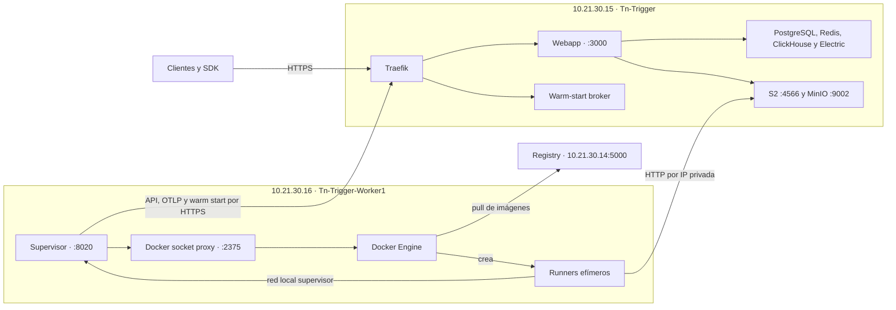

# Operación de TriggerEU Prod

La última revisión de TriggerEU Prod observó `v4.5.4` en una sola instancia repartida entre dos servidores gestionados por Coolify. `Tn-Trigger` (`10.21.30.15`) aloja la Webapp y los datos. `Tn-Trigger-Worker1` (`10.21.30.16`) ejecuta el supervisor y los contenedores de tareas.

| Si necesitas… | Abre |
| --- | --- |
| Localizar un servicio, recurso de Coolify, red o volumen | [Inventario de producción](inventario.md) |
| Investigar una caída de la API, una ejecución en cola o un fallo de Sessions | [Guía de diagnóstico](diagnostico.md) |
| Consultar logs de la Webapp o medir CPU, memoria, disco y contenedores | [Observabilidad en Grafana](observabilidad.md) |
| Preparar un despliegue o revisar las recetas | [README de despliegue](../README.md) |
| Actualizar a `v4.8.3` y ensayar el rollback | [Plan de actualización](actualizacion-4.8.3.md) |

## Topología

En Coolify, los metadatos del proyecto son `teamnet-trigger-eu` y `production`. En Loki, selecciona `project="TriggerEU"` y `environment="Prod"`. `Prod` identifica esta infraestructura. Cuando investigues una ejecución, confirma además su entorno en Trigger.dev, ya que el worker aloja tareas de `staging` y `production`.

Inventario del 11 de noviembre de 2026. Tras un cambio de dominio, host o recurso de Coolify, comprueba los nombres activos en Docker y actualiza el inventario y los selectores de Grafana.
